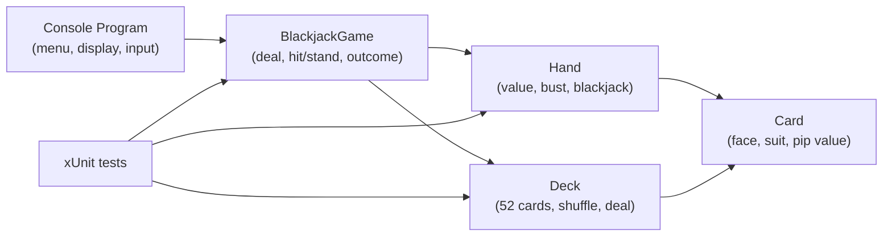
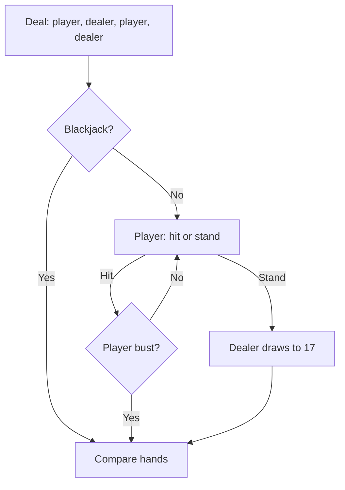

# Console Blackjack

[](https://github.com/enonymous1/console-blackjack/actions/workflows/ci.yml)
[](LICENSE)


<!-- Visual asset pending: capture docs/images/console-blackjack-gameplay.gif
     (one full round: menu, deal with the dealer's second card hidden, one
     hit, dealer busts) in Windows Terminal and uncomment the image line
     below. It is deliberately not linked until the file exists, so the
     README never renders a broken image. -->
<!--  -->

## Description

Console Blackjack is a small C# console game: play blackjack against a
dealer, or shuffle and inspect a 52-card deck. The game logic lives in
a testable core library with no console I/O, and the console project
is only a menu and a display.

Rules in brief: cards are dealt alternating player, dealer, player,
dealer. Number cards count at face value, face cards count 10, and an
ace counts 11 when that does not bust the hand, otherwise 1. Hit (`h`)
to take another card, stand (`s`) to stop; hitting to 21 stands
automatically. The dealer draws until reaching 17 and stands on all
17s, including soft 17. Blackjack on the first two cards wins
immediately unless the dealer has it too, which is a push.

## Prerequisites

- Git.
- The [.NET 10 SDK](https://dotnet.microsoft.com/download/dotnet/10.0).
  Check with `dotnet --list-sdks` — you need a 10.0.x entry.
- A terminal with UTF-8 support for the suit glyphs (♠ ♥ ♣ ♦).
  Windows Terminal works; on an older console the glyphs may render
  as boxes, but the game still plays.

## Installation

Clone the repository:

```sh
git clone https://github.com/enonymous1/console-blackjack.git
cd console-blackjack
```

Or download a release zip for your platform from the
[Releases](https://github.com/enonymous1/console-blackjack/releases)
page, extract it, and run `blackjack` (Windows: `blackjack.exe`).
The release builds are self-contained, so no .NET SDK is needed to
run them. There is no published package to install.

## Local Development

Run the game:

```sh
dotnet run --project src/Blackjack
```

The menu is:

```text
1. Play Blackjack
2. Shuffle and Show Deck
3. Exit
```

Build, test, and format (all from the repository root):

```sh
dotnet build console-blackjack.sln --configuration Release
dotnet test console-blackjack.sln --configuration Release
dotnet format console-blackjack.sln --verify-no-changes
```

The test suite is 36 xUnit cases, including rigged-deck games that
cover blackjacks, busts, and the dealer standing on 17 and soft 17.
Tests run in CI on Ubuntu and Windows.

<!-- Visual asset pending: capture docs/images/deck-display.png (option 2:
     a shuffled 52-card deck in four rows of thirteen) and uncomment the
     image line below. -->
<!--  -->

### Project layout

```text
src/Blackjack.Core/   Cards, deck, hand values, and game rules.
                      No console I/O, so it is all unit-testable.
src/Blackjack/        Console menu and display only.
tests/Blackjack.Tests/ xUnit tests, including rigged-deck games.
```



### Troubleshooting

- **Suit glyphs show as boxes:** switch to a UTF-8 terminal with a
  font that includes ♠ ♥ ♣ ♦, such as Windows Terminal. The game
  itself is unaffected.
- **Piped input exits immediately:** that is intentional. When input
  is redirected, end-of-input exits cleanly instead of looping, so
  scripted runs work (for example, `"2","3" | dotnet run --project
  src/Blackjack` in PowerShell shows the deck and exits).

## Deployment

There is no installer. Releases are automated: pushing a tag
matching `v*.*.*` (for example `v2.1.0`) runs
`.github/workflows/release.yml`, which runs the test suite, then
publishes self-contained builds for win-x64, linux-x64, and
osx-arm64 and attaches one zip per platform to a GitHub Release.
Tags with a `-` suffix (for example `v2.2.0-rc1`) are marked as
pre-releases. Tag pushes do not trigger CI (it runs on pushes to
`main` and pull requests), so the release workflow runs the tests
itself before publishing.

To publish a standalone build by hand from the repository root:

Framework-dependent (small, requires the .NET 10 runtime on the
target machine):

```sh
dotnet publish src/Blackjack --configuration Release
```

The output is in `src/Blackjack/bin/Release/net10.0/`; run
`blackjack` (Windows: `blackjack.exe`, Linux/macOS: `blackjack`).

Self-contained (no runtime needed on the target machine, roughly
80 MB because it bundles the runtime):

```sh
dotnet publish src/Blackjack --configuration Release --runtime win-x64 --self-contained true
dotnet publish src/Blackjack --configuration Release --runtime linux-x64 --self-contained true
dotnet publish src/Blackjack --configuration Release --runtime osx-arm64 --self-contained true
```


## How to play

See Description for the rules. During a hand, the dealer's second
card is hidden until you stand (or bust). Hearts and diamonds print
in red on a colour terminal; piped output is plain text with no
screen clearing.



## Contributing

Issues and pull requests are welcome. Please run `dotnet build`,
`dotnet test`, and `dotnet format --verify-no-changes` before
submitting, and keep the core library free of console I/O.

## License

MIT. See [LICENSE](LICENSE).
